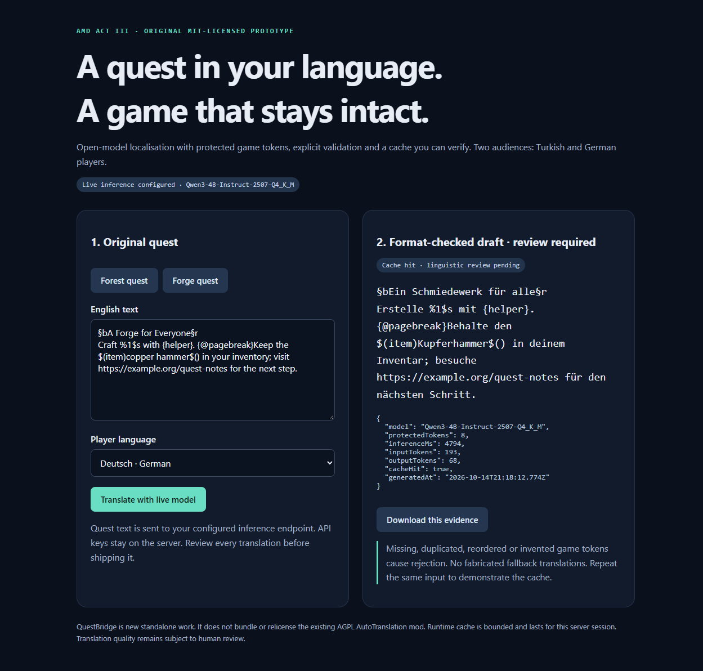

# QuestBridge

An original, standalone **MIT-licensed** localisation prototype for AMD Developer Hackathon ACT III. It addresses a concrete need from the author's existing Minecraft translation project: localise quest text for different players while keeping game placeholders and formatting intact.



## Run

Node.js 24 or newer. No package dependencies or install step.

```powershell
$env:AMD_ENDPOINT = "https://YOUR-AMD-INFERENCE-HOST/v1/chat/completions"
$env:AMD_MODEL = "YOUR-CATALOGUE-MODEL-ID"
$env:AMD_API_KEY = "YOUR-KEY"
npm start
```

Open **http://127.0.0.1:4186**. Use a real open-model endpoint provisioned through the [event's AMD Token Factory](https://notebooks.amd.com/tokenfactory), or a verified AMD-hosted endpoint. The model and endpoint are deliberately not guessed. HTTPS is required remotely; HTTP is accepted on loopback for local inference. Never commit a key or put it in the URL.

Without these variables the UI still runs, but live translation clearly returns **503 / not configured**. No prerecorded translation is presented as live inference.

## Demo path

1. Choose the original **Forest quest** and Turkish. Generate a real translation.
2. Check the returned protected-token count, model, token usage (when the provider supplies it) and measured request latency.
3. Select German and generate for a second audience.
4. Generate the Forge quest in German and repeat the identical input. A cache hit avoids a new model call.
5. Download each result's evidence as JSON. Review translation quality manually before accepting it for a game.

The sample quest text was written for this prototype. It is not taken from third-party modpacks.

## Architecture and limits

`browser → Node HTTP server → separate immutable game syntax → translate natural-language fragments → reassemble and validate → bounded cache → browser`

- A fresh implementation separates Minecraft colour codes, printf placeholders, named placeholders, page breaks, Patchouli-style commands and URLs. Their positions and original values remain under host control.
- The model returns a JSON-schema-constrained array of translated fragments. Changed array structure and invented game syntax are rejected. The host reassembles fragments around immutable tokens, then validates again.
- Invalid outputs and fully copied English are not cached; errors remain visible. There is no invented translation fallback.
- The cache holds at most 500 accepted translations **in memory for this server session**. Locale, source, model and endpoint form the cache identity. Identical in-flight requests are coalesced; at most four unique calls run concurrently.
- Keys are used only by the server. Remote redirects are refused. API responses and evidence do not contain the key.
- Validation proves syntax preservation, **not linguistic accuracy**. Fixed syntax boundaries can make some translated word orders awkward; output is a reviewable localisation draft. This is a prototype constraint, not universal format support.
- Host CPU details do not prove the inference backend's accelerator. Record the real endpoint and its official provisioned hardware separately.

## Verification

```powershell
npm test
```

Focused tests use an explicitly mocked inference endpoint to cover damaged placeholders, cache isolation/coalescing, invalid-output rejection and unavailable inference. **Mocks are not AMD hardware evidence.** Live evidence is recorded separately only after actual model calls succeed.

## Container

```bash
docker build -t questbridge-amd .
docker run --rm -p 127.0.0.1:4186:4186 \
  -e AMD_ENDPOINT -e AMD_MODEL -e AMD_API_KEY questbridge-amd
```

The server binds to loopback outside the container. This demo has no public-user authentication; keep it local or behind your authenticated hosting gateway.

## Project relationship and originality

[AutoTranslation](https://github.com/yuefdev/minecraft-ai-translator) is pre-existing **AGPL-3.0** software based partly on Moirstral's upstream. QuestBridge is independently written new work and contains no copied mod code, binaries or assets. It neither bundles nor relicenses the mod. This prototype demonstrates localisation through its own browser UI; automatic mod integration has not been claimed.

AI coding assistance was used to implement this prototype. All delivered code, tests and evidence are reviewable. Hardware access, actual inference and contest eligibility must be verified; enrolment alone is not claimed as completed participation.

## Acceptance evidence

See [`evidence/STATUS.md`](evidence/STATUS.md) and [`evidence/CPU_RESULTS.md`](evidence/CPU_RESULTS.md) for the actual state, including failed trials and linguistic limitations. Pending provisioning and an unsubmitted project are not successful hackathon participation.
